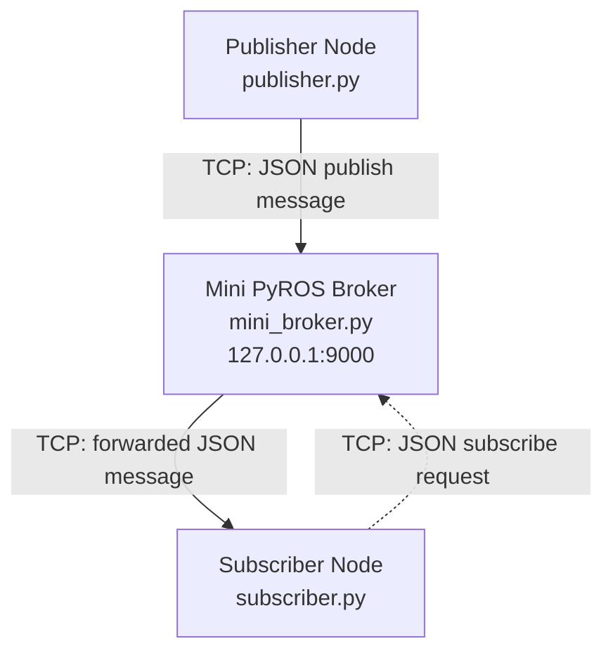
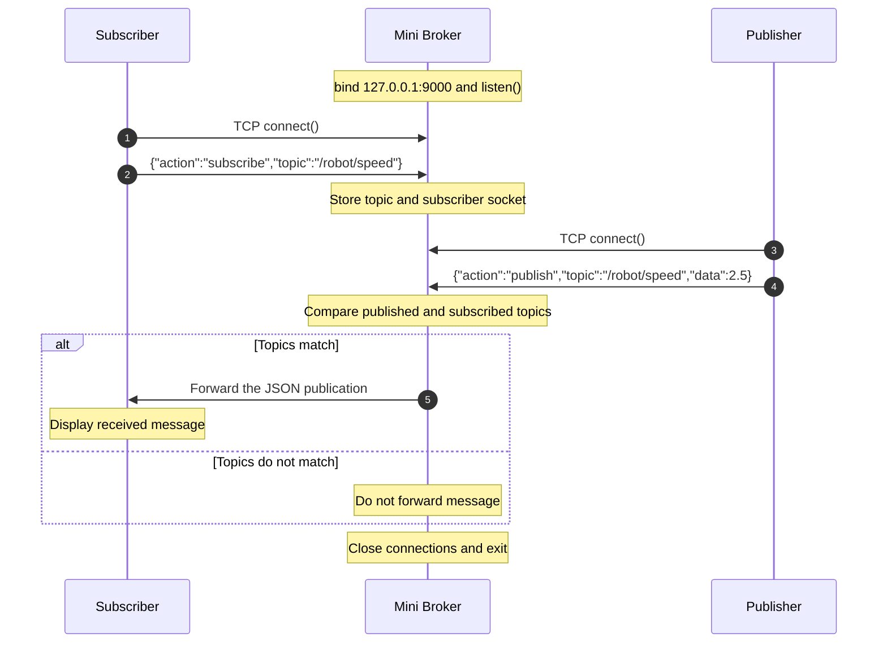
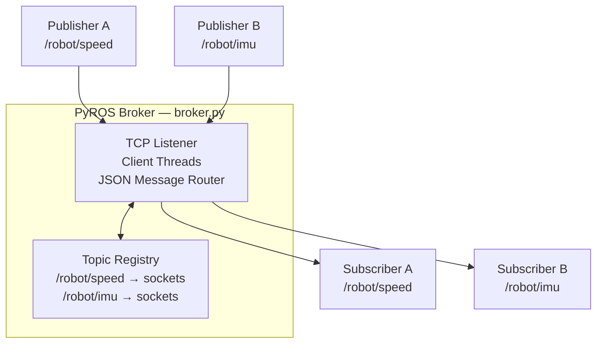

# Mini PyROS — Architecture

> A small, educational **publisher–subscriber messaging system** built from scratch in Python using TCP sockets and JSON.

## 1. Overview

Mini PyROS demonstrates the basic idea of topic-based messaging: a **publisher** creates data, a **broker** routes it by topic, and a **subscriber** receives it. The components are independent Python processes communicating over TCP on the same computer.

This is a **ROS-inspired learning project**, not an implementation of ROS or ROS 2. Unlike a typical ROS 2 system (which uses DDS-based discovery and communication), Mini PyROS routes messages through one central TCP broker.

## 2. Architecture Diagram



**What each component does**

| Component | File | Role |
|---|---|---|
| Broker | `mini_broker.py` | Accepts connections, reads the subscriber's topic, receives the publisher's message, compares topics, and forwards matching data. |
| Publisher | `publisher.py` | Connects to the broker and publishes a JSON message on a named topic. |
| Subscriber | `subscriber.py` | Connects to the broker, requests a topic, and waits to receive matching data. |
| TCP | Python `socket` module | Transfers bytes between the three processes. |
| JSON | Python `json` module | Encodes message fields such as `action`, `topic`, and `data`. |

## 3. Project Structure

```text
Mini_PyROS/
├── mini_broker.py          # Central routing process
├── publisher.py            # Example publishing client
├── subscriber.py           # Example subscribing client
└── MINI_PYROS_ARCHITECTURE.md
```

## 4. Communication Protocol

Mini PyROS exchanges JSON-encoded messages over TCP.

**Subscription request** sent by the subscriber:

```json
{
  "action": "subscribe",
  "topic": "/robot/speed"
}
```

**Publication** sent by the publisher:

```json
{
  "action": "publish",
  "topic": "/robot/speed",
  "data": 2.5
}
```

The broker sends the publication JSON to the subscriber when its `topic` matches the subscribed topic. In this mini prototype, the broker directly reads one request from each connection. It does not yet implement a robust multi-message framing protocol.

## 5. Step-by-Step Message Flow



1. Run the broker. It binds to `127.0.0.1:9000` and listens for incoming connections.
2. Run the subscriber. It connects **first** and sends `/robot/speed` as its subscription topic.
3. The broker stores that subscriber connection and topic.
4. Run the publisher. It connects **second** and sends its JSON publication.
5. The broker compares the publication topic with the subscription topic.
6. If the topics match, the broker forwards the JSON publication to the subscriber.
7. The simple broker closes both connections and finishes after this one exchange.

## 6. Running the Project

Open **three separate terminals** from the project directory and run them **in this order**:

**Terminal 1 — Broker**

```bash
python mini_broker.py
```

**Terminal 2 — Subscriber**

```bash
python subscriber.py
```

**Terminal 3 — Publisher**

```bash
python publisher.py
```

Expected subscriber output (Python dictionary representation):

```text
Received: {'action': 'publish', 'topic': '/robot/speed', 'data': 2.5}
```

> **Important:** This version accepts the subscriber first and then the publisher. Starting the publisher before the subscriber can cause the broker to misinterpret which role connected, because the mini broker relies on connection order.

## 7. Design Decisions

- **Local loopback (`127.0.0.1`)** keeps the experiment on one machine.
- **Port `9000`** identifies the broker's listening TCP endpoint.
- **TCP** offers reliable, ordered byte delivery, but does not itself preserve application message boundaries.
- **JSON** provides human-readable structured messages.
- **Topic matching** lets publishers and subscribers use a shared name rather than communicating directly with each other.
- **Central broker** makes routing simple to understand and debug, at the cost of introducing a single routing dependency.

## 8. Current Limitations

This **mini broker** deliberately has a limited scope:

| Limitation | Consequence | Future improvement |
|---|---|---|
| Expects exactly one subscriber and one publisher | Cannot support a robot with many simultaneous nodes | Add a loop around `accept()` and per-client threads |
| Assumes subscriber connects before publisher | Connection order determines behavior | Interpret the `action` field for each client |
| Assumes one `recv(1024)` contains a whole JSON message | TCP can split or combine data, so parsing may fail | Use newline-delimited JSON or length-prefixed messages |
| Processes one publication, then exits | Cannot stream ongoing sensor readings | Use persistent connections and message-processing loops |
| Does not validate every incoming message | Malformed messages can fail unexpectedly | Add validation and error handling |
| No authentication, encryption, or QoS | Not suitable for production or safety-critical use | Add security and delivery policy where necessary |

## 9. Planned Multi-Client Architecture

The next stage replaces the single stored subscriber with a mapping from **topic → subscribed socket connections**.



Core building blocks for that upgrade:

```python
import threading

subscribers = {}               # topic -> set of client sockets
lock = threading.Lock()        # protects the shared topic registry
```

Each accepted connection gets its own handler thread. A `subscribe` action registers the socket under a topic. A `publish` action finds subscribers of that topic and forwards the message. The broker cleans up disconnected connections. Real implementations also need to coordinate writes to any shared socket and handle slow receivers.

## 10. Learning Outcomes

By building Mini PyROS, you practice:

- Creating TCP servers and clients with Python sockets.
- Binding, listening, connecting, accepting, sending, and receiving.
- Converting Python data to and from JSON.
- Routing messages by topic.
- Distinguishing an educational prototype from a concurrent, continuously running message broker.
- Understanding the conceptual foundation for more advanced ROS-style communication.

---

**Project status:** Working educational prototype — one subscriber, one publisher, one routed message.
